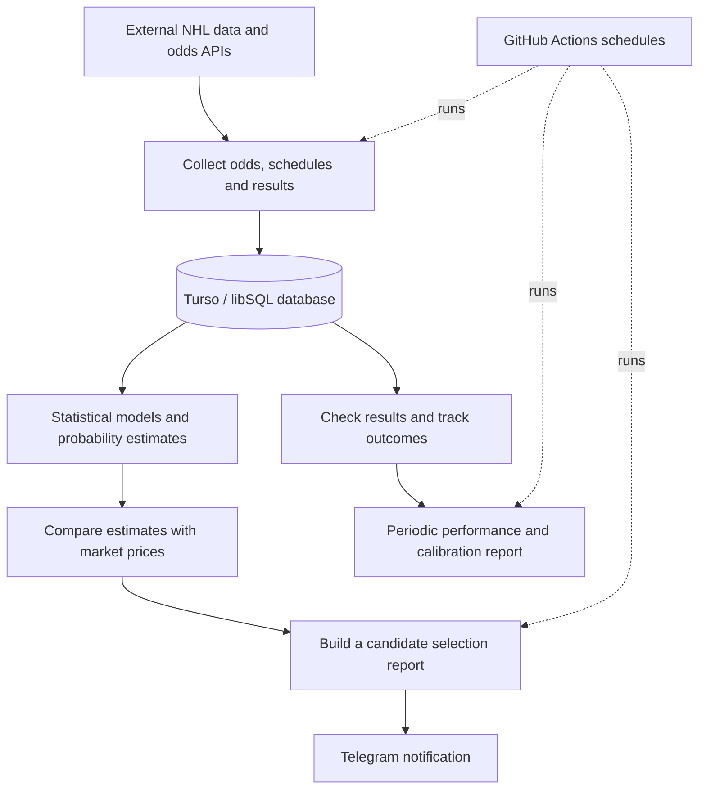

<div align="center">

# Betting Agent

**An automated NHL odds-analysis and statistical modelling project**

A Python project that collects hockey data and bookmaker odds, estimates probabilities with statistical models, evaluates market prices, and automates reporting through GitHub Actions and Telegram.


</div>

---

## Overview

Betting Agent is a personal software project exploring how data collection, probability modelling, and scheduled automation can be combined into a repeatable analysis pipeline for NHL games.

The system gathers odds and results from external data sources, stores information in a database, compares model estimates with market prices, and can send generated reports to Telegram. A human reviews any suggested selections and places any bets manually.

> **Project scope:** The current implementation uses statistical methods and machine-learning components. It does not rely on a large language model (LLM), and its estimates should not be interpreted as guaranteed outcomes or evidence of profitability.

## How it works



## Key features

- **Automated data collection** — retrieves odds, schedules, historical games, and result data from external APIs.
- **Probability modelling** — includes Poisson-based score and market probability calculations, plus scikit-learn classification workflows.
- **Market comparison** — evaluates model probabilities against available odds and filters candidate selections using configurable rules.
- **Player-prop analysis** — includes player-stat data collection and a shrinkage-based probability estimate for selected player markets.
- **Result tracking** — stores generated selections and checks them against completed NHL games.
- **Scheduled workflows** — GitHub Actions can run the daily pipeline and a separate periodic recalibration/reporting task.
- **Notifications** — sends reports to Telegram when the required credentials are configured.

The project is under active development. Model quality, calibration, coverage of markets, and long-term performance need to be evaluated with sufficiently large out-of-sample datasets; no profitability claim is made.

## Technology stack

| Area | Technologies / approach |
| --- | --- |
| Language | Python |
| Data processing | pandas, NumPy |
| Statistical modelling | Poisson distributions, probability estimation and calibration |
| Machine learning | scikit-learn, including logistic regression and gradient boosting components |
| Data storage | Turso / libSQL |
| API integration | `requests`, external NHL and odds data APIs |
| Configuration | Environment variables and `python-dotenv` |
| Workflow automation | GitHub Actions |
| Reporting | Telegram Bot API |

## Repository structure

```text
.
├── .github/workflows/
│   ├── daily_bet.yml          # Scheduled data and report pipeline
│   └── recalibrate.yml        # Periodic results / calibration report
├── data/                      # Placeholder for local data
├── notebooks/                 # Placeholder for exploratory notebooks
├── src/
│   ├── build_combo.py         # Builds candidate selections and reports
│   ├── check_results.py       # Checks recorded selections against results
│   ├── collect_results.py    # Collects historical results and statistics
│   ├── fetch_sgo.py           # Fetches odds from the SGO API
│   ├── fetch_odds.py          # Fetches odds from another odds API
│   ├── market_model.py        # Market probability calculations
│   ├── poisson_model.py       # Poisson-based match estimates
│   ├── props_model.py         # Player-prop probability calculations
│   ├── train_model.py         # Model training and evaluation workflow
│   ├── win_model.py           # Match outcome model utilities
│   └── recalibrate.py         # Periodic reporting workflow
├── .env.example               # Environment-variable template
├── requirements.txt           # Python dependencies
└── README.md
```

## Getting started

### 1. Requirements

- Python 3.13 (matching the configured GitHub Actions workflows)
- API access for the data sources you intend to use
- A Turso database for workflows that read or write persistent state
- A Telegram bot and chat ID if you want Telegram notifications

### 2. Create an environment

Clone the repository and open its directory:

```bash
git clone https://github.com/Bolar66/betting-agent.git
cd betting-agent
python -m venv .venv
```

Activate the virtual environment:

**Windows PowerShell**

```powershell
.\.venv\Scripts\Activate.ps1
```

**macOS / Linux**

```bash
source .venv/bin/activate
```

Install dependencies:

```bash
python -m pip install -r requirements.txt
```

### 3. Configure environment variables

Copy `.env.example` to `.env` and add your own credentials. Never commit `.env` or real API keys to Git.

Variables used by the automated workflow include:

| Variable | Purpose |
| --- | --- |
| `SGO_API_KEY` | Access to the Sportsgameodds API used by the scheduled workflow |
| `TURSO_DATABASE_URL` | Turso database URL |
| `TURSO_AUTH_TOKEN` | Authentication token for the database |
| `TELEGRAM_BOT_TOKEN` | Telegram bot authentication |
| `TELEGRAM_CHAT_ID` | Destination for Telegram reports |
| `ODDS_API_KEY` | Used by scripts that access the separate odds API |

Not every script needs every variable. Configure only the credentials needed for the workflow you intend to run.

### 4. Run the workflow

The GitHub Actions workflows are configured to run on a schedule and can also be started manually from the repository's **Actions** tab using **Run workflow**, provided the required repository secrets are configured.

For local execution, start with the relevant script after configuring its environment variables. For example:

```bash
python src/fetch_sgo.py
python src/build_combo.py
```

These commands depend on valid API credentials and database configuration; they are not a standalone demo mode.

### 5. Configure GitHub Actions secrets

In the GitHub repository, open **Settings → Secrets and variables → Actions** and add the required secrets for the workflow:

- `SGO_API_KEY`
- `TURSO_DATABASE_URL`
- `TURSO_AUTH_TOKEN`
- `TELEGRAM_BOT_TOKEN`
- `TELEGRAM_CHAT_ID`

Add `ODDS_API_KEY` only if you plan to run workflows or scripts that require it. Never put secret values directly in workflow files, source code, or the README.

## Development notes

- Probability estimates are model outputs, not guarantees. Historical results do not ensure future performance.
- Before drawing conclusions about model performance, use time-aware backtesting, calibration metrics, and an adequate out-of-sample period.
- API availability, rate limits, and data quality can affect the pipeline.
- The repository contains exploratory and diagnostic scripts as well as the main workflow; not every script is intended to be run as part of the daily job.

## Responsible use

This project is for software development and statistical experimentation. It is not financial advice, and no betting outcome or return is guaranteed. Any suggested selections are reviewed and placed manually by a human.

## Authors

Ruge & Smolge
